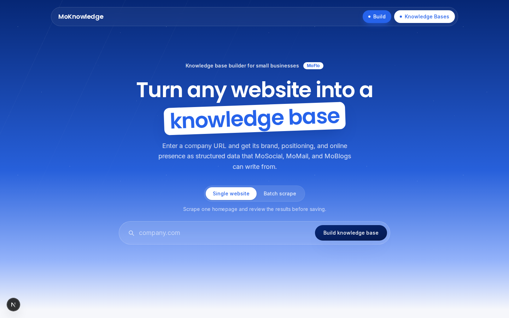
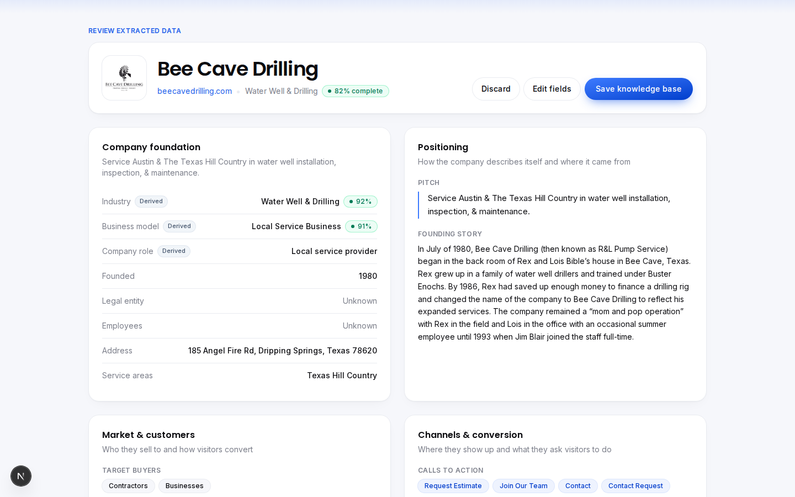
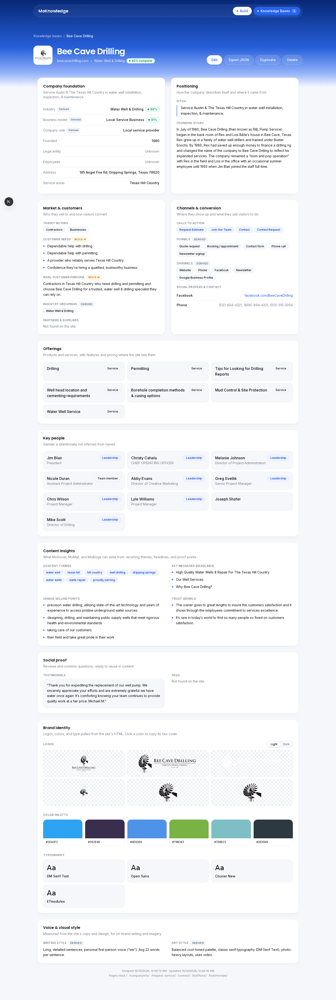
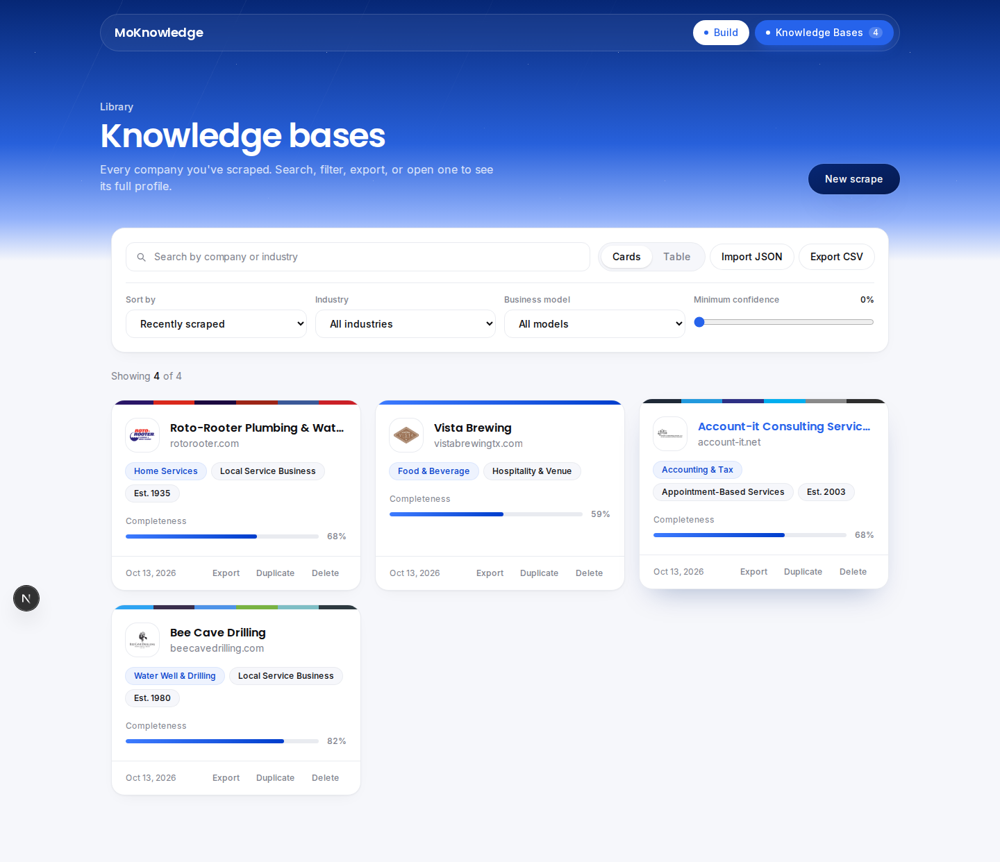

# MoKnowledge

MoKnowledge turns a company's website into a structured knowledge base: who they are, what they sell, who they sell to, how they talk, and what their brand looks like. MoFlo's apps (MoSocial, MoMail, MoBlogs) would use this knowledge base to write on-brand content for that business.

You type in a website, the app reads it, shows you what it found, lets you fix anything, and saves it as JSON.



---

## Run it

Requires Node.js 20 or newer.

```bash
npm install
npm run dev
```

Open http://localhost:3000. No API keys or database needed. Knowledge bases are saved in your browser.

---

## What it does

**Build page (`/knowledge`)**
- Enter one website, or switch to **Batch** and paste a list.
- A progress message shows which pages are being read.
- Review everything that was found, organized by category.
- Edit any field (lists, people, offerings, FAQs included), then save.

**Knowledge bases page (`/knowledge/view`)**
- Card view and table view, with search and filters (industry, business model, completeness).
- Click any company for its full profile page, including logos, brand colors, and fonts.
- Edit, duplicate, delete, export JSON or CSV, and import JSON.

| Review results | Full profile | Library |
|---|---|---|
|  |  |  |

More in [`screenshots/`](screenshots).

---

## How the scraping works

Four steps, each in its own file:

1. **Fetch** (`src/app/api/scrape/route.ts`, `src/utils/scraper.ts`)
   The browser can't download other websites directly (CORS), so a small server route fetches the HTML. The app reads the homepage, then finds up to 5 more useful pages from its links: About, Services, Contact, Team, FAQ, and Reviews. That's where addresses, staff, and founding stories usually live.

2. **Extract** (`src/utils/extract/`)
   Each page is parsed once, and small focused functions pull out one kind of data each:
   - `structuredData.ts` reads schema.org data many sites embed for Google. It's the most reliable source for address, phone, founding date, FAQs, and reviews.
   - `contact.ts`: phones (from `tel:` links), emails, addresses, service areas, social profiles
   - `company.ts`: founding year and story, legal entity (LLC, Inc.), CTAs, headlines, trust signals
   - `offerings.ts`: services/products from the menu's "Services" dropdown and service sections
   - `people.ts`: team members and titles
   - `socialProof.ts`: testimonials, FAQs, ratings
   - `brand.ts`: logos, brand colors, fonts
   - `style.ts`: writing style (sentence length, "you" vs "we") and art style (palette, fonts, imagery)

3. **Classify** (`src/utils/classifier.ts`)
   Industry and business model are picked by counting keyword matches. Words in the title, description, and main headings count 3×, and CTA buttons like "Get a Quote" or "Add to Cart" count extra for business model. The confidence % shows how clearly the winner beat the other options.

4. **Assemble** (`src/utils/parser.ts`)
   Combines everything into one `Knowledge` object (`src/types/knowledge.ts`) and records where each value came from.

### Where each value came from

Every field is tagged so you know what to trust:

| Tag | Meaning | Example |
|---|---|---|
| *(none)* | Read directly from the website | Address, phone, founding year |
| **Derived** | Calculated by a rule from what was found | Industry, channels, writing style |
| **Mock AI** | Placeholder for an LLM step (no AI is called) | Customer needs, ideal persona |
| **Edited** | Changed by a person | Anything you edit |

The assignment allows mock AI output if it's clearly labeled. Each Mock AI field maps to a real prompt in [`prompts/EXAMPLE_PROMPTS.md`](prompts/EXAMPLE_PROMPTS.md).

---

## Knowledge base structure

All the categories from the assignment, plus extras that help content generation:

- **Company foundation**: overview, industry, business model, role, founded, legal entity, employees, address, service areas, other names
- **Positioning**: pitch, founding story
- **Market & customers**: target buyers, customer needs, ideal persona, industry groupings, channels, funnels, CTAs, partners
- **Branding & style**: writing style, art style, fonts, colors, logos
- **Online presence**: social links, phone, email
- **Key people**: name, title, role, background
- **Offerings**: name, category, description, features, pricing
- **Beyond the baseline**: content themes, key headlines, unique selling points, trust signals, testimonials, rating, FAQs, mission/values, media mentions
- **Metadata**: which pages were read, completeness score, where each value came from

Real output from the scraper (not hand-edited): [`examples/beecavedrilling.json`](examples/beecavedrilling.json), [`examples/account-it.json`](examples/account-it.json), [`examples/vistabrewing.json`](examples/vistabrewing.json).
`examples/handwritten-target-account-it.json` is a hand-written example of what a fully AI-enriched record could look like. It is **not** scraper output.

---

## AI prompts

[`prompts/EXAMPLE_PROMPTS.md`](prompts/EXAMPLE_PROMPTS.md) has 6 prompts. The most important is **Prompt 0**, which fills fields the rules couldn't. Its key rules:
- Use only the website text, never outside knowledge.
- Return `null` instead of guessing.
- Include a quote from the page as evidence for every value.
- Don't overwrite values the scraper already verified.

---

## Handling missing data

- **Show it as missing, don't invent it.** Empty fields display "Not found on the site" or "Unknown".
- **Try more than one source.** For example, address comes from structured data, then the Contact page, then any text that looks like a US address.
- **Skip boilerplate.** Menus, footers, cookie banners, and terms-of-service popups are removed before reading text, so a website vendor's address or email isn't mistaken for the company's.
- **Completeness score.** The % on each card is the share of baseline fields that were filled.
- **People fix the rest.** Every field is editable, and edits are tagged.

## Ideas for enrichment beyond the website

- Google Business Profile for hours, reviews, photos, and categories.
- Review sites (Yelp, BBB, Facebook) for real customer language.
- The company's social accounts, for tone and what gets engagement.
- Competitor websites in the same area, to find what makes this company different.
- State business registries for legal name, entity type, and founding date.
- A short onboarding questionnaire for things websites rarely say (ideal customer, seasonal busy times).

---

## Database design

See [`docs/DATABASE_SCHEMA.md`](docs/DATABASE_SCHEMA.md) for the Supabase design. In short:
- **Organizations** (MoFlo accounts) own **companies**.
- Each save creates a new, unchangeable **knowledge base version**, so there's full history and easy rollback.
- **Scrape runs** keep the raw pages, so extraction can be improved and re-run.
- **Row Level Security** means users only see their own organization's data.

---

## Project structure

```
src/
  app/
    knowledge/page.tsx            Build page (scrape, review, edit, save)
    knowledge/view/page.tsx       Knowledge bases list
    knowledge/view/[id]/page.tsx  Single company profile
    api/scrape/route.ts           Server-side page fetcher
  components/                     UI (form, batch scraper, display, editor, list)
  context/KnowledgeContext.tsx    Shared state + saving to localStorage
  types/knowledge.ts              The knowledge base schema
  utils/
    scraper.ts                    Fetch homepage + key subpages
    parser.ts                     Runs all extractors, builds the knowledge base
    extract/                      One file per kind of data
    classifier.ts                 Industry, business model, themes
    derive.ts                     Rule-based fields (channels, funnels, role)
    mockAi.ts                     Labeled placeholders for AI-generated fields
    storage.ts                    JSON/CSV export and import
```

---

## Assumptions and limitations

- **Built on Next.js 16** (the assignment says 15). The App Router features used are the same.
- **Reads HTML only.** Sites that build their content with JavaScript after loading show less.
- **Rule-based extraction is best-effort.** It works well on typical small-business sites (WordPress, Squarespace, Wix), less well on unusual layouts. That's why everything is editable and labeled.
- **Address detection is tuned for US formats**, and text analysis for English.
- **Storage is per browser** (`localStorage`). The database design above is the production plan.
- **The scrape route blocks internal addresses** (localhost, private networks). Production would also limit request rates.

## Other documents

- [`QUESTIONS.md`](QUESTIONS.md): answers to the five required questions
- [`prompts/EXAMPLE_PROMPTS.md`](prompts/EXAMPLE_PROMPTS.md): AI enrichment prompts
- [`docs/DATABASE_SCHEMA.md`](docs/DATABASE_SCHEMA.md): Supabase schema, versioning, and security
